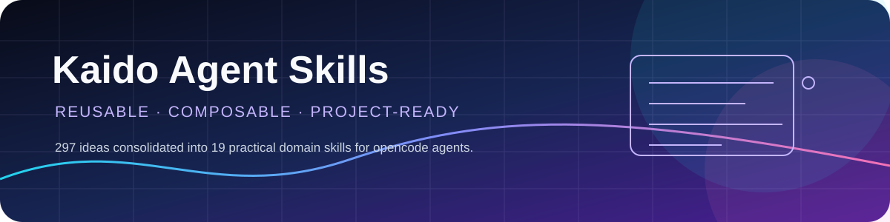
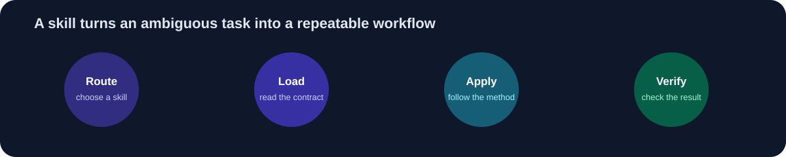

<div dir="rtl" align="center">



<br>

<a href="https://github.com/Dev-KAIDO/agent-skills"></a>
<a href="https://opencode.ai"></a>
<a href="#المهارات-الـ19"></a>
<a href="#التثبيت"></a>

# Kaido Agent Skills

### مكتبة مهارات عملية للوكيل الذكي — قابلة لإعادة الاستخدام والتركيب

<p><strong>297 مهارة أصلية</strong> جرى تنظيمها داخل <strong>19 مهارة مجالية شاملة</strong>، لتنتقل من فكرة مبهمة إلى سير عمل واضح يمكن للوكيل تطبيقه والتحقق منه.</p>

</div>

---

## الفكرة في سطر واحد

بدل أن تحمل عشرات المهارات المتفرقة لكل مشروع، حمّل مكتبة واحدة، ثم استدعِ المهارة المناسبة بصيغة بسيطة:

```text
$design-web build a focused landing page for a coffee brand
```

كل مهارة هنا ليست مجرد prompt طويل؛ بل **عقد عمل** يحدد متى تستخدم، ماذا تقرأ، كيف تنفذ، وكيف تتحقق من النتيجة.



## لماذا هذه المكتبة؟

<table>
<tr>
<td width="25%" align="center"><h2>🧭</h2><strong>توجيه</strong><br><sub>اختر المهارة الأقرب للمهمة</sub></td>
<td width="25%" align="center"><h2>🧩</h2><strong>تركيب</strong><br><sub>اربط مهارات متعددة كسلسلة</sub></td>
<td width="25%" align="center"><h2>🛡️</h2><strong>جودة</strong><br><sub>اختبار وأمان وتحقق مستمر</sub></td>
<td width="25%" align="center"><h2>📦</h2><strong>قابلية نقل</strong><br><sub>انسخها إلى أي مشروع أو جهاز</sub></td>
</tr>
</table>

## التثبيت

### 1. استنسخ المكتبة

```bash
git clone https://github.com/Dev-KAIDO/agent-skills.git
```

### 2. ضع مجلد المهارات في مسار دائم

اجعل المجلد مستقلًا عن مشاريعك حتى لا يختفي عند حذف مشروع:

```text
~/.kaido-skills/skills/<skill-name>/SKILL.md
```

في Windows:

```text
C:\Users\<user>\.kaido-skills\skills\<skill-name>\SKILL.md
```

### 3. اربطه مع opencode

أضف المسار إلى الإعدادات العامة في `~/.config/opencode/opencode.jsonc`:

```jsonc
{
  "skills": {
    "paths": ["/home/<user>/.kaido-skills/skills"]
  }
}
```

وفي Windows:

```jsonc
{
  "skills": {
    "paths": ["C:\\Users\\<user>\\.kaido-skills\\skills"]
  }
}
```

> بعد ذلك تصبح المهارات متاحة من أي مشروع، وأي جلسة، وأي نموذج يدعم صيغة `$<skill-name>`.

## طريقة الاستدعاء

```text
$design-web create a responsive dashboard for a research lab
$backend-comprehensive design a REST API with authentication
$security-comprehensive review this pull request for OWASP risks
$testing-comprehensive add end-to-end tests for the checkout flow
```

المهارة تُستدعى باسمها كما هو، والشرطات جزء من الاسم:

```text
$agent-workflows
$documentation-comprehensive
$cityofaiagents-operations
```

<details>
<summary><strong>قاعدة مهمة قبل استدعاء أي مهارة</strong></summary>
<br>

1. اقرأ `SKILL.md` أولًا.
2. افحص الـ frontmatter وتأكد أن وصف المهارة يطابق المهمة.
3. التزم بالمنهجية المحددة داخل المهارة.
4. نفّذ التحقق المطلوب قبل إعلان اكتمال العمل.
5. إذا كانت المهمة متعددة المراحل، استخدم سلسلة مهارات بدل مهارة واحدة.

</details>

## سلاسل جاهزة للمهام المركبة

```text
واجهة ويب:
$design-web → $code-engineering → $testing-comprehensive

خدمة خلفية جديدة:
$backend-comprehensive → $database-comprehensive → $security-comprehensive → $testing-comprehensive

تطبيق جوال:
$design-mobile → $mobile-development → $testing-comprehensive → $deployment-comprehensive

إصلاح عميق:
$repair-stability → $code-engineering → $testing-comprehensive → $devops-comprehensive

مراجعة أمنية:
$security-comprehensive → $code-engineering → $testing-comprehensive

توثيق مشروع:
$documentation-comprehensive → $testing-comprehensive
```

## المهارات الـ19

<div dir="ltr">

| # | Skill | المجال | متى تستخدمها؟ |
|---:|---|---|---|
| 01 | `design-web` | Web Design | واجهات الويب، التخطيط، التجربة البصرية |
| 02 | `design-mobile` | Mobile Design | تصميم تجارب iOS / Android |
| 03 | `design-desktop` | Desktop Design | تطبيقات سطح المكتب والنوافذ والتفاعل |
| 04 | `design-figma` | Figma | ملفات Figma، المكونات، والتسليم للتطوير |
| 05 | `code-engineering` | Code Engineering | جودة الكود، الهيكلة، وإعادة البناء |
| 06 | `backend-comprehensive` | Backend | APIs، الخدمات، المصادقة، والأداء |
| 07 | `database-comprehensive` | Data | قواعد البيانات، النمذجة، والاستعلامات |
| 08 | `mobile-development` | Mobile Development | Expo وReact Native وتطبيقات الجوال |
| 09 | `multimedia-content` | Multimedia | الصور، الفيديو، الصوت، والمحتوى الإبداعي |
| 10 | `testing-comprehensive` | Testing | الاختبارات، التغطية، والتحقق من الجودة |
| 11 | `security-comprehensive` | Security | OWASP، المخاطر، والمراجعة الأمنية |
| 12 | `repair-stability` | Repair | إصلاح الأعطال وتحسين الاستقرار |
| 13 | `devops-comprehensive` | DevOps | البنية التحتية، CI/CD، والرصد |
| 14 | `deployment-comprehensive` | Deployment | النشر، التسليم، والجاهزية للإنتاج |
| 15 | `integrations` | Integrations | ربط الخدمات وواجهات الطرف الثالث |
| 16 | `project-management` | Project Management | النطاق، الأولويات، والمراحل |
| 17 | `agent-workflows` | Agent Workflows | تنظيم عمل الوكيل وسلاسل التنفيذ |
| 18 | `documentation-comprehensive` | Documentation | توثيق المشاريع والقرارات والاستخدام |
| 19 | `cityofaiagents-operations` | Operations | عمليات CityOfAIAgents وإجراءاتها |

</div>

## بنية المكتبة

```text
agent-skills/
├── README.md                         # هذا الدليل
├── CONSOLIDATION_PLAN.md             # خطة الدمج والتحقق
├── assets/                           # رسومات README المحلية
│   ├── skills-banner.svg
│   └── skill-loop.svg
└── skills/
    ├── design-web/
    │   ├── SKILL.md                  # العقد والمنهجية
    │   ├── scripts/                  # أدوات تنفيذية عند الحاجة
    │   └── references/               # مراجع تفصيلية عند الحاجة
    ├── backend-comprehensive/
    ├── security-comprehensive/
    └── ... (19 skill domains)
```

كل مهارة تتبع بنية `SKILL.md` وتحتوي على `name` و`description` واضحين، مع `scripts/` و`references/` عندما تحتاج المهمة إلى أدوات أو معرفة إضافية.

<details>
<summary><strong>نصائح للمبتدئين</strong></summary>
<br>

1. ابدأ بالمهارة التي تصف **المشكلة**، لا التقنية التي تتخيل استخدامها.
2. استخدم 2–4 مهارات مترابطة عندما تكون المهمة أكبر من مرحلة واحدة.
3. مهارات `testing` و`security` لا تعني أن كل شيء آمن أو صحيح تلقائيًا؛ اقرأ النتائج ونفّذ التحقق.
4. اجعل كل خطوة قابلة للتراجع، خصوصًا قبل النشر أو تعديل بيانات مهمة.
5. حدّث المهارات عندما تتغير بنية مشروعك أو طريقة عملك.

</details>

## الحالة والاتجاه

- ✅ دمج 297 مهارة أصلية في 19 مجالًا عمليًا.
- ✅ بنية مستقلة قابلة للنسخ والعمل عبر المشاريع.
- ✅ أمثلة استدعاء وسلاسل جاهزة للمهام الشائعة.
- 🔄 تحسين المهارات تدريجيًا بناءً على الاستخدام الفعلي.
- 🔄 إضافة أمثلة تطبيقية ومراجع أعمق لكل مجال عند الحاجة.

## الترخيص

استخدم المكتبة وانسخها وعدّلها وشاركها في مشاريعك الشخصية والتجارية. راجع محتوى كل مهارة قبل اعتمادها في بيئة إنتاجية.

---

<div dir="rtl" align="center">

**Kaido Agent Skills** · اجعل الوكيل أكثر تنظيمًا، قابلية للتكرار، وأسهل في التحقق.

<a href="https://github.com/Dev-KAIDO"></a>

</div>
