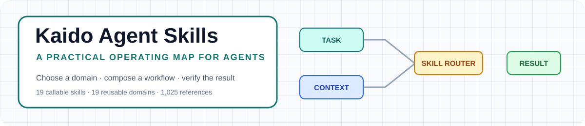
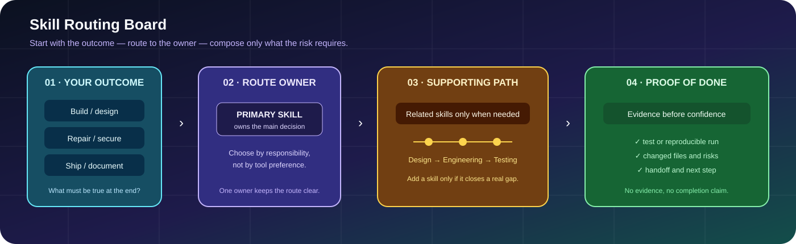
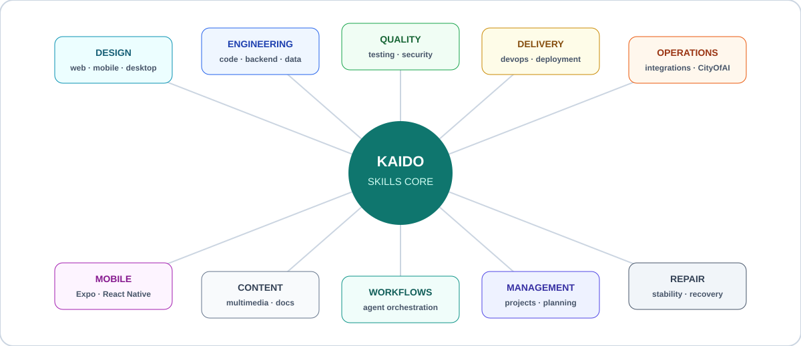
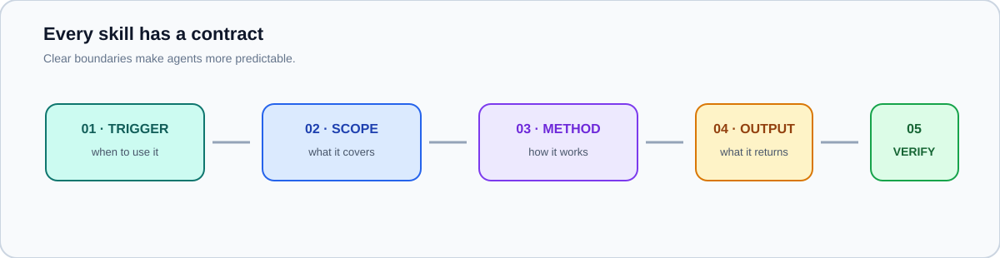
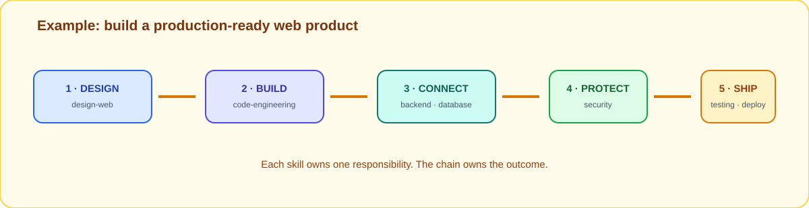

<div align="center">



<br><br>

<a href="https://github.com/Dev-KAIDO/agent-skills"></a>
<a href="https://opencode.ai"></a>
<a href="#لوحة-توجيه-المهارات"></a>
<a href="#التحقق"></a>

# Kaido Agent Skills

### لوحة توجيه عملية للوكلاء — اختر المسؤولية، ركّب المسار، وأثبت النتيجة

<p><strong>مكتبة مهارات منظمة تساعد الوكيل على الانتقال من مهمة غير واضحة إلى تنفيذ قابل للمراجعة والتسليم.</strong></p>

</div>

---

## ما هذه المكتبة؟

`agent-skills` ليست مجلد prompts عشوائيًا، وليست مجموعة أوامر جاهزة للاستخدام بلا سياق. هي **نظام توجيه وتشغيل** يتكون من مهارات قابلة للاستدعاء، ومراجع تفصيلية، وسكربتات مساعدة، وقواعد تحقق.

كل مهارة لها مسؤولية واضحة:

1. تحدد متى تُستخدم ومتى لا تُستخدم.
2. تقرأ السياق والمراجع الضرورية قبل التنفيذ.
3. تتبع منهجية قابلة للتطبيق.
4. تنتج مخرجًا يمكن فحصه.
5. تسلّم أدلة ومخاطر وخطوة تالية عند الحاجة.

## الأرقام المؤكدة

| المؤشر | القيمة | المعنى |
| --- | ---: | --- |
| ملفات `SKILL.md` القابلة للاستدعاء | **19** | المهارات الرئيسية التي يستدعيها الوكيل بصيغة `$name` |
| المجالات العملية | **19** | كل مجال يملك عقدًا ومنهجية ومخرجات تحقق |
| الملفات المتتبعة في Git | **1,189** | المهارات والمراجع والسكربتات والتوثيق |
| ملفات المراجع | **1,025** | معرفة تفصيلية تُقرأ عند الحاجة |
| نتيجة المدقق | **0 أخطاء · 0 تحذيرات** | آخر تحقق آلي للمكتبة |

> الأرقام التاريخية في تقارير التجميع تصف مصادر سابقة قبل الدمج، وليست عدد المهارات الحالية القابلة للاستدعاء.

## الوصول السريع

<div align="center">

<table>
<tr>
<td align="center"><a href="#لوحة-توجيه-المهارات"><br><strong>🧭 التوجيه</strong></a></td>
<td align="center">➜</td>
<td align="center"><a href="#التثبيت"><br><strong>⚙️ التثبيت</strong></a></td>
<td align="center">➜</td>
<td align="center"><a href="#الاستدعاء"><br><strong>▶️ الاستدعاء</strong></a></td>
<td align="center">➜</td>
<td align="center"><a href="#وصفات-جاهزة"><br><strong>🔗 التركيب</strong></a></td>
<td align="center">➜</td>
<td align="center"><a href="#التحقق"><br><strong>✅ الإثبات</strong></a></td>
</tr>
</table>

<sub><strong>Route the outcome → install the library → invoke the owner → compose only when needed → prove the handoff.</strong></sub>

</div>

## لوحة توجيه المهارات

ابدأ من **النتيجة التي تريدها**، لا من اسم الأداة التي تعرفها. اللوحة التالية تلخص طريقة الاختيار:



### كيف تستخدم اللوحة؟

| السؤال | القرار |
| --- | --- |
| ما الذي يجب أن يكون صحيحًا في النهاية؟ | صِغ النتيجة والقيود، ولا تبدأ باسم مهارة |
| من يملك القرار الرئيسي؟ | اختر مهارة واحدة مالكة للمسار |
| ما الفجوة المتبقية؟ | أضف مهارة مساندة فقط إذا أغلقت خطرًا حقيقيًا |
| كيف نعرف أن العمل انتهى؟ | حدّد اختبارًا أو تشغيلًا قابلًا للإعادة وأدلة تسليم |

> **قاعدة التوجيه:** مهارة رئيسية واحدة واضحة أفضل من سلسلة طويلة لا يملك أحد مسؤوليتها.

### بوابة اختيار سريعة

| إذا كنت تريد... | ابدأ بـ | أضف عند الحاجة | دليل النهاية |
| --- | --- | --- | --- |
| تصميم واجهة ويب | `design-web` | `code-engineering` → `testing-comprehensive` | معاينة، حالات تفاعل، وفحص استجابة |
| بناء تطبيق جوال | `design-mobile` | `mobile-development` → `testing-comprehensive` | تدفقات شاشة وتشغيل على المنصة المستهدفة |
| إنشاء API أو خدمة خلفية | `backend-comprehensive` | `database-comprehensive` → `security-comprehensive` | عقد API، اختبارات، ومراجعة مخاطر |
| إصلاح عطل غامض | `repair-stability` | `code-engineering` → `testing-comprehensive` | إعادة إنتاج، سبب جذري، واختبار منع الرجوع |
| مراجعة أمان | `security-comprehensive` | `testing-comprehensive` | نتائج قابلة لإعادة الإنتاج وخطة معالجة |
| إطلاق مشروع | `devops-comprehensive` | `deployment-comprehensive` | سجل نشر، health check، وخطة رجوع |
| تنظيم عمل وكيل | `agent-workflows` | `project-management` → `documentation-comprehensive` | مراحل، handoff، وحالة قابلة للتتبع |
| توثيق قرار أو نظام | `documentation-comprehensive` | `project-management` | مستند مفهوم ومصادر وقرارات معلنة |

## خريطة المجالات



| العائلة | المهارات | السؤال الذي تجيب عنه |
| --- | --- | --- |
| **التصميم** | `design-web` · `design-mobile` · `design-desktop` · `design-figma` | كيف يجب أن تبدو التجربة وتعمل؟ |
| **الهندسة** | `code-engineering` · `backend-comprehensive` · `database-comprehensive` | كيف نبني أساسًا صحيحًا وقابلًا للصيانة؟ |
| **الجودة والأمان** | `testing-comprehensive` · `security-comprehensive` | كيف نثبت أن الحل يعمل وآمن؟ |
| **التسليم** | `devops-comprehensive` · `deployment-comprehensive` | كيف يصل المنتج إلى المستخدم بثبات؟ |
| **الإصلاح** | `repair-stability` | كيف نعالج السبب لا العرض؟ |
| **التكامل والبيانات** | `integrations` · `database-comprehensive` | كيف ننظم البيانات ونربط الأنظمة؟ |
| **الجوال والوسائط** | `mobile-development` · `multimedia-content` | كيف نبني تطبيقًا أو محتوى متعدد الوسائط؟ |
| **الوكيل والعمليات** | `agent-workflows` · `cityofaiagents-operations` | كيف ننظم العمل متعدد الخطوات؟ |
| **الإدارة والتوثيق** | `project-management` · `documentation-comprehensive` | كيف نحافظ على القرار والمعرفة؟ |

## عقد المهارة

المهارة هي وحدة تشغيل صغيرة لها حدود ومخرج، وليست إجابة عامة.



يجب أن يوضح كل `SKILL.md` على الأقل:

| الجزء | وظيفته |
| --- | --- |
| `name` | الاسم الذي يستدعى بصيغة `$name` |
| `description` | متى تستخدم المهارة وما الإشارة التي تستدعيها |
| **Scope** | ما تغطيه المهارة وما لا تغطيه |
| **Workflow** | خطوات العمل بالترتيب |
| **Verification** | كيف نراجع النتيجة قبل التسليم |
| **References** | أين توجد المعرفة الأعمق |

## التثبيت

### 1. نسخ المستودع

```bash
git clone https://github.com/Dev-KAIDO/agent-skills.git
```

### 2. وضع مسار دائم

ضع مجلد `skills/` في مسار لا يختفي بحذف مشروعك:

```text
~/.kaido-skills/skills/
```

على Windows:

```text
C:\Users\<user>\.kaido-skills\skills\
```

### 3. إعداد opencode

في `~/.config/opencode/opencode.jsonc`:

```jsonc
{
  "skills": {
    "paths": ["/home/<user>/.kaido-skills/skills"]
  }
}
```

على Windows:

```jsonc
{
  "skills": {
    "paths": ["C:\\Users\\<user>\\.kaido-skills\\skills"]
  }
}
```

بعدها تصبح المهارات متاحة من أي مشروع عبر `$<skill-name>`.

## الاستدعاء

الصيغة الأساسية:

```text
$<skill-name> <task and constraints>
```

أمثلة:

```text
$design-web build a responsive landing page for a coffee brand
$backend-comprehensive design a REST API with rate limiting
$security-comprehensive review this pull request for OWASP risks
$testing-comprehensive add end-to-end tests for the checkout flow
```

### صيغة استدعاء أفضل

لا تكتفِ باسم المهارة؛ أعطها النتيجة والقيود ودليل النجاح المتوقع:

```text
$repair-stability
Reproduce the checkout failure, identify the root cause,
make the smallest safe fix, and add a regression test.
Return changed files, evidence, remaining risks, and next step.
```

## وصفات جاهزة

### وصفة 01 — واجهة من الفكرة إلى التحقق

```text
$design-web
→ $code-engineering
→ $testing-comprehensive
```

**المخرجات:** تصور واضح، تنفيذ منظم، ثم تحقق من السلوك والاستجابة.

### وصفة 02 — API آمن وقابل للنشر

```text
$backend-comprehensive
→ $database-comprehensive
→ $security-comprehensive
→ $testing-comprehensive
→ $deployment-comprehensive
```

**المخرجات:** عقد API، نموذج بيانات، مراجعة مخاطر، اختبارات، وخطة تسليم.

### وصفة 03 — إصلاح عطل غير واضح

```text
$repair-stability
→ $code-engineering
→ $testing-comprehensive
```

**المخرجات:** إعادة إنتاج، سبب جذري، إصلاح محدود، واختبار يمنع عودة المشكلة.

### وصفة 04 — مشروع جوال

```text
$design-mobile
→ $mobile-development
→ $testing-comprehensive
→ $deployment-comprehensive
```

**المخرجات:** تدفق شاشات، تنفيذ Expo أو React Native، تحقق، وجاهزية للإصدار.

### وصفة 05 — نظام وكيل قابل للتتبع

```text
$agent-workflows
→ $project-management
→ $documentation-comprehensive
→ $testing-comprehensive
```

**المخرجات:** مراحل واضحة، نقاط handoff، سجل قرارات، ومعايير تحقق.



## ما داخل المهارة؟

```text
skills/<skill-name>/
├── SKILL.md          # العقد، النطاق، المنهجية، والتحقق
├── scripts/          # أدوات قابلة للتشغيل عند الحاجة
└── references/       # معرفة تفصيلية لا تُحمّل إلا عند الحاجة
```

التصميم المقصود هو أن يبقى `SKILL.md` موجزًا وقابلًا للتوجيه، بينما تُحفظ التفاصيل الثقيلة في `references/` ولا تُقرأ إلا عندما يتطلبها السياق.

## فهرس المهارات الـ19

| # | Skill | مجال المسؤولية |
|---:|---|---|
| 01 | `design-web` | تصميم واجهات الويب |
| 02 | `design-mobile` | تصميم تجارب iOS وAndroid |
| 03 | `design-desktop` | تصميم تطبيقات سطح المكتب |
| 04 | `design-figma` | Figma والتسليم التصميمي |
| 05 | `code-engineering` | جودة الكود والمعمارية |
| 06 | `backend-comprehensive` | APIs والأنظمة الخلفية |
| 07 | `database-comprehensive` | نمذجة البيانات والاستعلامات |
| 08 | `mobile-development` | Expo وReact Native |
| 09 | `multimedia-content` | إنتاج المحتوى والوسائط |
| 10 | `testing-comprehensive` | الاختبار والتحقق |
| 11 | `security-comprehensive` | الأمن ومراجعة OWASP |
| 12 | `repair-stability` | التصحيح والاستقرار |
| 13 | `devops-comprehensive` | البنية وCI/CD |
| 14 | `deployment-comprehensive` | الإصدار والتسليم |
| 15 | `integrations` | التكامل مع الخدمات الخارجية |
| 16 | `project-management` | النطاق والأولويات والتخطيط |
| 17 | `agent-workflows` | تنسيق الوكلاء وسلاسل العمل |
| 18 | `documentation-comprehensive` | التوثيق والقرارات |
| 19 | `cityofaiagents-operations` | عمليات CityOfAIAgents |

## التحقق

لا يكفي أن يبدو المستودع مرتبًا؛ يجب أن تكون العقود والمراجع والملفات قابلة للفحص.

<div align="center">


</div>

شغّل المدقق من جذر المستودع:

```bash
python3 tools/validate_skills.py
```

المخرج المتوقع:

```text
============================================================
Kaido skills validation — 19 skills checked
============================================================
RESULT: PASS — 0 errors, 0 warning(s)
```

## بوابات الجودة قبل التسليم

| البوابة | سؤال المراجعة | دليل مقبول |
| --- | --- | --- |
| **الفهم** | هل فُهمت المهمة والقيود؟ | ملخص نطاق واضح وافتراضات معلنة |
| **التوجيه** | هل اختيرت المهارة المالكة فعلًا؟ | سبب اختيار ومسؤولية واحدة واضحة |
| **النطاق** | هل عُدّلت الملفات الضرورية فقط؟ | diff صغير ومفهوم |
| **السلوك** | هل تعمل النتيجة في المسار الأساسي؟ | اختبار أو تشغيل قابل لإعادة الإنتاج |
| **المخاطر** | هل راجعنا الأمن والحالات الطرفية والتراجع؟ | قائمة مخاطر وخطوات متابعة |
| **التسليم** | هل يستطيع شخص آخر فهم ما حدث؟ | ملفات، أدلة، روابط، وخطوة تالية |

> لا يوجد ادعاء اكتمال بلا دليل تشغيل أو تحقق مناسب للسياق.

## المساهمة بمهارة جديدة

أضف مهارة جديدة فقط عندما يظهر نمط متكرر ومستقل لا تغطيه المهارات الحالية. لا تضف مهارة لمجرد زيادة العدد.

### خطوات المساهمة

1. سمِّ المهارة باسم يصف المجال لا الأداة.
2. اكتب `description` يوضح متى تستخدم ومتى لا تستخدم.
3. حدّد المالك والنطاق والحدود.
4. افصل المنهجية عن المراجع الطويلة داخل `references/`.
5. ضع السكربتات القابلة للتكرار داخل `scripts/`.
6. أضف مخرجًا واضحًا ومعيار تحقق.
7. شغّل المدقق وجرّب المهارة على مهمة حقيقية قبل دمجها.

### فحص قبل الإضافة

```text
[ ] الاسم فريد وقابل للاستدعاء بصيغة $skill-name
[ ] الوصف يطابق حالات الاستخدام الفعلية
[ ] المهارة لا تكرر مسؤولية موجودة
[ ] النطاق والحدود واضحان
[ ] الخطوات قابلة للتطبيق وليست شعارات عامة
[ ] المخرجات ومعايير التحقق محددة
[ ] لا توجد معلومات سرية أو مسارات خاصة بالجهاز
[ ] python3 tools/validate_skills.py يمر بلا أخطاء
```

## الحالة الحالية

- ✅ 19 مهارة قابلة للاستدعاء منظمة داخل 19 مجالًا.
- ✅ لوحة توجيه لاختيار المهارة المالكة والمسار المساند.
- ✅ وصفات جاهزة لسيناريوهات شائعة.
- ✅ عقود مهارات ومراجع وسكربتات منظمة.
- ✅ مدقق آلي: 19/19، و0 أخطاء، و0 تحذيرات.
- 🔄 إضافة أمثلة تشغيلية أعمق لكل مجال حسب الاستخدام الفعلي.
- 🔄 توسيع التحقق إلى اختبارات سلوكية للمخرجات عند توفر أمثلة تشغيلية.

## المصادر والإسناد

توجد تفاصيل المصادر المدمجة وإشعارات التراخيص في [`CREDITS.md`](CREDITS.md). راجعها قبل إعادة توزيع المحتوى المدمج في مشروع آخر.

## الترخيص والاستخدام

استخدم المكتبة بعد مراجعة المهارة والمراجع والأوامر بما يناسب سياقك. لا تعتبر وجود مهارة أو نجاح المدقق ضمانًا تلقائيًا لصحة كل قرار إنتاجي؛ تبقى مسؤولية التحقق النهائي على منفذ المهمة.

---

<div align="center">

**Route clearly · Compose deliberately · Prove the result**

<a href="https://github.com/Dev-KAIDO"></a>

</div>
