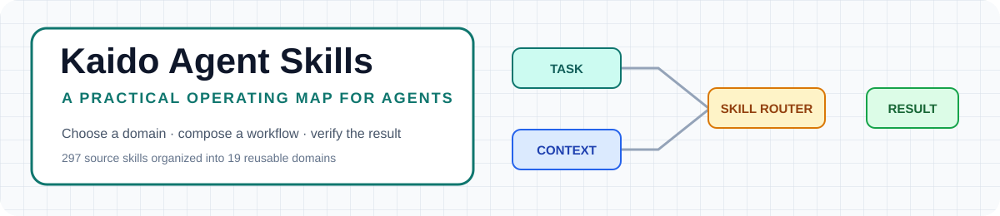
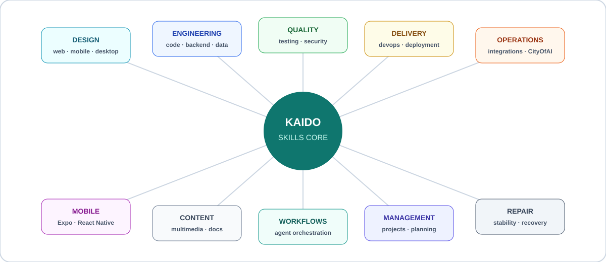
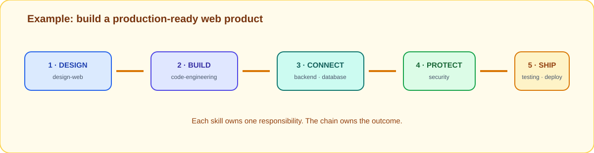

<div align="center">



<br><br>

<a href="https://github.com/Dev-KAIDO/agent-skills"></a>
<a href="https://opencode.ai"></a>
<a href="#خريطة-المكتبة"></a>
<a href="#وصفة-تنفيذ"></a>

# Kaido Agent Skills

### نظام تشغيل صغير للمهارات — وليس مجلد prompts عشوائيًا

</div>

> **297 مهارة أصلية → 19 مجالًا عمليًا → سلاسل تنفيذ قابلة لإعادة الاستخدام**

هذه المكتبة تجمع المهارات التي يحتاجها الوكيل أثناء العمل الحقيقي: يفهم المهمة، يختار المسار، يقرأ عقد المهارة، ينفذ مسؤولية محددة، ثم يتحقق من النتيجة قبل الانتقال للخطوة التالية.

## كيف تفكر في المشروع؟

المهارة ليست إجابة جاهزة، وليست أمرًا سحريًا. اعتبرها **وحدة تشغيل صغيرة** لها أربعة أجزاء:

1. **متى تُستخدم؟** — نطاق واضح يمنع اختيار المهارة الخطأ.
2. **ماذا تقرأ؟** — ملفات ومراجع وسياق تحتاجه قبل التنفيذ.
3. **كيف تعمل؟** — منهجية وخطوات ومعايير قرار.
4. **كيف تتحقق؟** — فحوصات ومخرجات تمنع إعلان النجاح مبكرًا.



## خريطة المكتبة

المكتبة مقسمة إلى عائلات. لا تحتاج إلى حفظ كل الأسماء؛ ابدأ من المجال الذي يصف مشكلتك ثم كوّن سلسلة صغيرة:

| العائلة | المهارات | السؤال الذي تجيب عنه |
| --- | --- | --- |
| **التصميم** | `design-web` · `design-mobile` · `design-desktop` · `design-figma` | كيف يجب أن تبدو التجربة وتعمل؟ |
| **الهندسة** | `code-engineering` · `backend-comprehensive` · `database-comprehensive` | كيف نبني أساسًا صحيحًا وقابلًا للصيانة؟ |
| **الجودة** | `testing-comprehensive` · `security-comprehensive` | كيف نثبت أن الحل يعمل وآمن؟ |
| **التسليم** | `devops-comprehensive` · `deployment-comprehensive` | كيف يصل المنتج إلى المستخدم بثبات؟ |
| **الإصلاح** | `repair-stability` | كيف نفهم العطل ونصلح السبب لا العرض؟ |
| **البيانات والتكامل** | `database-comprehensive` · `integrations` | كيف ننظم البيانات ونربط الأنظمة؟ |
| **الجوال والوسائط** | `mobile-development` · `multimedia-content` | كيف نبني تطبيقًا أو محتوى متعدد الوسائط؟ |
| **الوكيل والعمليات** | `agent-workflows` · `cityofaiagents-operations` | كيف ننظم العمل المتعدد الخطوات؟ |
| **الإدارة والتوثيق** | `project-management` · `documentation-comprehensive` | كيف نحافظ على القرار والمعرفة؟ |

## دورة التشغيل

```text
مهمة مبهمة
   ↓
تحديد المجال والقيود
   ↓
اختيار مهارة أو سلسلة
   ↓
قراءة SKILL.md والمراجع
   ↓
تنفيذ مسؤولية واحدة
   ↓
اختبار ومراجعة المخرجات
   ↓
الانتقال للمهارة التالية أو تسليم النتيجة
```

<details>
<summary><strong>قاعدة اختيار المهارة</strong></summary>
<br>

لا تبدأ من الأداة التي تحبها؛ ابدأ من الخطر أو النتيجة التي تريدها:

- تريد تجربة أفضل؟ ابدأ بـ `design-*`.
- تريد كودًا أنظف؟ استخدم `code-engineering`.
- تريد خدمة أو API؟ استخدم `backend-comprehensive`.
- تريد بيانات منظمة؟ استخدم `database-comprehensive`.
- تريد اكتشاف الأخطاء؟ استخدم `testing-comprehensive`.
- تريد تقليل المخاطر؟ استخدم `security-comprehensive`.
- تريد فهم عطل غامض؟ استخدم `repair-stability`.
- تريد إطلاق ما بنيته؟ استخدم `deployment-comprehensive`.
- تريد تنسيق وكيل أو مراحل متعددة؟ استخدم `agent-workflows`.

</details>

## التثبيت

### 1. النسخ

```bash
git clone https://github.com/Dev-KAIDO/agent-skills.git
```

### 2. مسار دائم

انسخ أو اربط مجلد `skills/` في مكان لا يختفي بحذف مشروعك:

```text
~/.kaido-skills/skills/
```

على Windows:

```text
C:\Users\<user>\.kaido-skills\skills\
```

### 3. إعداد opencode

في `~/.config/opencode/opencode.jsonc`:

```jsonc
{
  "skills": {
    "paths": ["/home/<user>/.kaido-skills/skills"]
  }
}
```

على Windows:

```jsonc
{
  "skills": {
    "paths": ["C:\\Users\\<user>\\.kaido-skills\\skills"]
  }
}
```

بعدها تصبح المهارات متاحة من أي مشروع عبر `$<skill-name>`.

## الاستدعاء الأساسي

```text
$design-web build a clear landing page for a coffee brand
$backend-comprehensive design a REST API with rate limiting
$security-comprehensive review this pull request for OWASP risks
$testing-comprehensive add end-to-end tests for the checkout flow
```

صيغة الاستدعاء:

```text
$<skill-name> <task and constraints>
```

أمثلة أسماء صحيحة:

```text
$agent-workflows
$documentation-comprehensive
$cityofaiagents-operations
```

## وصفة تنفيذ: كيف تندمج المهارات؟

المهارات لا تتنافس على المهمة؛ كل واحدة تملك جزءًا من المسؤولية. مثال بناء منتج ويب جاهز للنشر:



```text
$design-web
  → $code-engineering
  → $backend-comprehensive
  → $database-comprehensive
  → $security-comprehensive
  → $testing-comprehensive
  → $deployment-comprehensive
```

### متى نستخدم سلسلة؟

استخدم سلسلة عندما تكون النتيجة النهائية تعتمد على أكثر من نوع من الحكم:

- الواجهة وحدها لا تكفي دون هندسة.
- الكود لا يكفي دون اختبار.
- الاختبار لا يكفي دون أمان.
- المنتج لا يكتمل دون نشر وتوثيق.

## وصفات جاهزة

<details>
<summary><strong>وصفة 01 — واجهة ويب من الفكرة إلى التحقق</strong></summary>
<br>

```text
$design-web
→ $code-engineering
→ $testing-comprehensive
```

**المخرجات المتوقعة:** تصور واضح، تنفيذ منظم، ثم تحقق من السلوك والاستجابة.

</details>

<details>
<summary><strong>وصفة 02 — API آمن وقابل للنشر</strong></summary>
<br>

```text
$backend-comprehensive
→ $database-comprehensive
→ $security-comprehensive
→ $testing-comprehensive
→ $deployment-comprehensive
```

**المخرجات المتوقعة:** عقد API، نموذج بيانات، مراجعة مخاطر، اختبارات، وخطة تسليم.

</details>

<details>
<summary><strong>وصفة 03 — إصلاح عطل غير واضح</strong></summary>
<br>

```text
$repair-stability
→ $code-engineering
→ $testing-comprehensive
```

**المخرجات المتوقعة:** إعادة إنتاج، سبب جذري، إصلاح محدود، واختبار يمنع عودة المشكلة.

</details>

<details>
<summary><strong>وصفة 04 — مشروع جوال</strong></summary>
<br>

```text
$design-mobile
→ $mobile-development
→ $testing-comprehensive
→ $deployment-comprehensive
```

**المخرجات المتوقعة:** تدفق شاشات، تنفيذ Expo / React Native، تحقق، وجاهزية للإصدار.

</details>

## ما داخل المهارة؟

```text
skills/<skill-name>/
├── SKILL.md          # الاسم، الوصف، متى تستخدم، والمنهجية
├── scripts/          # أدوات قابلة للتشغيل عند الحاجة
└── references/       # معرفة تفصيلية لا تُحمّل إلا عند الحاجة
```

وكل `SKILL.md` يجب أن يوضح على الأقل:

| الجزء | وظيفته |
| --- | --- |
| `name` | الاسم الذي تستدعيه بصيغة `$name` |
| `description` | الإشارة التي تخبر الوكيل متى يستخدم المهارة |
| **Scope** | ما الذي تغطيه المهارة وما الذي لا تغطيه |
| **Workflow** | خطوات العمل بالترتيب |
| **Verification** | كيف نراجع النتيجة قبل تسليمها |
| **References** | أين يجد الوكيل المعرفة الأعمق |

<details>
<summary><strong>قالب مهارة مبسط</strong></summary>
<br>

```markdown
---
name: example-skill
description: Use when the task needs ...
---

# Example Skill

## Use when
...

## Workflow
1. Inspect the context.
2. Choose the smallest safe change.
3. Execute the work.
4. Verify the result.

## Output
Return evidence, changed files, and remaining risks.
```

</details>

## فهرس المهارات الـ19

<div dir="ltr">

| # | Skill | Domain |
|---:|---|---|
| 01 | `design-web` | Web interface design |
| 02 | `design-mobile` | iOS / Android experience design |
| 03 | `design-desktop` | Desktop application design |
| 04 | `design-figma` | Figma workflows and handoff |
| 05 | `code-engineering` | Code quality and architecture |
| 06 | `backend-comprehensive` | APIs and backend systems |
| 07 | `database-comprehensive` | Data modeling and queries |
| 08 | `mobile-development` | Expo and React Native |
| 09 | `multimedia-content` | Creative media workflows |
| 10 | `testing-comprehensive` | Testing and verification |
| 11 | `security-comprehensive` | Security and OWASP review |
| 12 | `repair-stability` | Debugging and stability |
| 13 | `devops-comprehensive` | Infrastructure and CI/CD |
| 14 | `deployment-comprehensive` | Release and delivery |
| 15 | `integrations` | External service integrations |
| 16 | `project-management` | Scope, priorities, and planning |
| 17 | `agent-workflows` | Agent orchestration |
| 18 | `documentation-comprehensive` | Documentation and decisions |
| 19 | `cityofaiagents-operations` | CityOfAIAgents operations |

</div>

## قواعد الجودة

- لا تستخدم مهارة لا يطابق وصفها المهمة.
- لا تعتبر وجود commit أو خروج نص من الوكيل دليلًا على نجاح العمل.
- افصل بين التنفيذ والمراجعة عندما تكون المخاطر عالية.
- اجعل المخرجات قابلة للفحص: ملفات، اختبارات، أدلة، أو روابط.
- لا تخفِ عدم اليقين؛ سجله كخطر أو خطوة متابعة.
- بعد كل سلسلة، راجع هل ما زالت المهارة التالية ضرورية أم أن النتيجة اكتملت.

## الحالة الحالية

- ✅ 297 مهارة أصلية منظمة داخل 19 مجالًا.
- ✅ استدعاء موحد بصيغة `$<skill-name>`.
- ✅ وصفات جاهزة لسيناريوهات شائعة.
- ✅ خريطة بصرية للمجالات وطريقة دمج المهارات.
- 🔄 إضافة أمثلة تشغيلية أعمق لكل مجال حسب الاستخدام الفعلي.
- 🔄 تحسين التحقق الآلي والاختبارات الخاصة بالمكتبة.

## الترخيص

انسخ وعدّل وشارك المكتبة في مشاريعك الشخصية والتجارية. راجع كل مهارة قبل استخدامها في بيئة إنتاجية، وتأكد من أن المراجع والأوامر مناسبة لسياقك.

---

<div align="center">

**Choose clearly · Compose deliberately · Verify everything**

<a href="https://github.com/Dev-KAIDO"></a>

</div>
